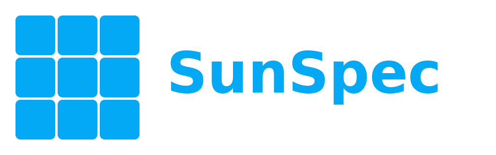

<picture>
  <source media="(prefers-color-scheme: dark)"
          srcset="custom_components/sunspec2/brand/dark_logo@2x.png">
  
</picture>

# SunSpec 2

> [!NOTE]
> **Update 2026.10.0:** the integration now talks to the inverter
> through the same connection code that Home Assistant's own
> integrations use. You see no difference: same entities, same options,
> nothing to migrate. The technical background is in the
> [release notes](https://github.com/hilman2/ha-sunspec2/releases/tag/v2026.10.0).

Connects solar inverters, meters and batteries to Home Assistant, if
they speak **SunSpec Modbus**. SunSpec is a standard that many makers
build into their inverters. Modbus is the way the data travels over
your network. You do not need to know more than that.

Set up entirely in the UI: enter the inverter's IP address or let the
integration search your network, tick the data you want, done. No YAML,
no template sensors.

What you get:

- Everything your inverter reports as a normal sensor: power, energy,
  voltages, currents, temperatures, operating state and error events
- The total energy produced since day one, ready to use in the Energy
  dashboard, with no template sensor in between
- One integration for every brand, so a SolarEdge and a KACO next to
  each other look the same in Home Assistant
- Sensors that ride out a shaky network instead of flickering to
  unavailable every few minutes
- Nonsense readings at dawn and dusk are filtered out before they reach
  your statistics
- A diagnostics download that makes a bug report easy to act on

## Will it work with my inverter?

If your inverter's manual mentions "SunSpec" or "Modbus TCP", very
likely yes. That covers most brands. Where a brand needs a special
setting, the entry links to a page with the details:

**ABB / FIMER / Power-One** Aurora, Trio, UNO, REACT .  
**APsystems** ECU-R, ECU-C (micro inverters, see [docs/apsystems.md](docs/apsystems.md)) .  
**Chint Power Systems**  
**Delta** Solivia, RPI .  
**Fronius** Symo, Primo, Eco, Galvo, GEN24, Verto, Tauro (see [docs/fronius.md](docs/fronius.md) and [docs/fronius-symo.md](docs/fronius-symo.md)) .  
**GoodWe** XS, DT, ET .  
**KACO** Powador, blueplanet .  
**Kostal** Plenticore, Piko (needs port 1502 and unit ID 71, see [docs/kostal.md](docs/kostal.md)) .  
**SAJ** R6 with the eSolar AIO3 module (see [docs/saj.md](docs/saj.md)) .  
**SMA** Sunny Boy, Tripower (needs unit ID 126, see [docs/sma.md](docs/sma.md)) .  
**SolarEdge** SE, HD-Wave, Energy Hub (see [docs/solaredge.md](docs/solaredge.md)) .  
**Sungrow** SG, SH .  
**SunPower** .  

Most inverters need Modbus TCP switched on in their own settings
before they answer. It is usually off from the factory. Look for
"Modbus" or "SunSpec" in the inverter's web page or app.

**Developed against a KACO Powador 7.8 TL3.** For everything else the
integration relies on the standard, so reports about other hardware are
welcome.

## Installation

The integration is in the default HACS store. It needs Home Assistant
2026.10 or newer.

1. **HACS** -> search for **SunSpec Modbus** -> **Download**
2. **Restart Home Assistant**
3. **Settings -> Devices & Services -> Add Integration -> SunSpec
   Modbus**
4. Choose how to connect:
   - **Enter IP address manually** if you know the inverter's IP
     address (look it up in your router)
   - **Scan my network** if you do not. The integration lists devices
     that could be an inverter
   - **Connect via serial port** if the inverter is wired with RS-485.
     That needs a USB adapter, which shows up as `/dev/ttyUSB0` on
     Linux or `COM3` on Windows
5. Keep the suggested port `502` and unit ID `1`, unless your inverter
   needs something else (check the page for your brand above). The
   port is the "door" on the inverter, the unit ID is the "address" of
   the device behind it. For a serial connection, enter the serial
   settings from your inverter's manual.
6. Tick the data you want sensors for. The default is a good start. You
   can change it later in the options

If your inverter gets a new IP address from your router, Home Assistant
may also find it on its own and offer it on the *Devices & Services*
page.

## Adding it to the Energy dashboard

Use the **Lifetime energy** sensor as your *Solar production* source
under **Settings -> Dashboards -> Energy**. Nothing else to set up.

The inverter reports that value in watt-hours (Wh), so the number gets
big after a few years. The Energy dashboard copes with that. If you
prefer kWh: open the sensor, click the cog, change **Unit of
Measurement**, and confirm when Home Assistant offers to convert your
existing history.

## Options

You can change these at any time under *Settings -> Devices & Services
-> SunSpec Modbus -> Configure*. The defaults suit most setups.
Polling and sensor selection appear first. Open **Advanced** for sensor
names, power filtering, standby and diagnostics, or **Privacy** for
usage statistics. Fronius web credentials have their own section.

| Option | Default | What it does |
|---|---|---|
| Sensor name prefix | empty | Text put in front of the sensor names, for example `Garage`. Useful with several inverters |
| Polling interval | 30 s | How often the inverter is asked for new values |
| Sensor models | sensible defaults | Which groups of data become sensors. The inverter lists them, the integration reads them |
| Peak AC power | read from the inverter | AC rating used to filter implausible readings, with higher allowances for DC and apparent power. See [Troubleshooting](docs/troubleshooting.md#a-sensor-shows-unknown-on-a-bright-day) |
| Model scan pause | 0.5 s | A pause while the integration maps what the inverter offers. Raise it if setup fails on slow inverters |
| Allow the inverter to go offline when idle | off | Stops the "unreachable" notification for inverters that vanish at night without saying so |
| Capture diagnostic registers | off | Puts what the inverter sent, unprocessed, into the diagnostics download. For bug reports |
| Send anonymous usage statistics | on | One request a day that counts active installations. See [Usage statistics](#usage-statistics) |

Host, port and unit ID are changed via **Reconfigure** in the same
menu.

## Usage statistics

Once a day the integration sends one request to the author's server, so
that the number of active installations can be counted. It is on by
default. Turn it off with **Send anonymous usage statistics** under
*Configure -> Privacy*, and nothing is sent.

**What is sent:**

- a random install ID, made on the first start and kept in
  `.storage/sunspec2.usage_stats`
- the version of the integration and of Home Assistant
- the vendor profile in use, for example `fronius`
- the number of entries

**What is not sent:** host, port, serial number, model, location and
readings.

The request goes to `analytics.fs-sys.de`, a Matomo server of the author.
It keeps no visitor log of these requests, only the counts. The code is in
[`usage_stats.py`](custom_components/sunspec2/usage_stats.py).

## Several inverters on one connection

Add the integration once per inverter, each time with the same IP
address and port (or the same serial port) and a different unit ID. The
integration takes turns on the connection by itself. That matters
because many inverters only talk to one program at a time. There is
nothing to switch on.

Each unit ID becomes its own device with its own sensors and options.

You cannot run this next to another program that reads the same
inverter over Modbus. That includes the old cjne integration, openHAB
and scripts. If you need that, put a Modbus proxy in front of the
inverter. A proxy is a small program that lets several programs share
one connection.

## Battery and export control

> **This can bite.** Writing to an inverter changes its settings. Some
> inverters keep a change through a restart, or refuse to hand control
> back. Limits on how much you may feed into the grid can also be
> regulated where you live.

Besides showing values, the integration can steer a battery and limit
how much power you feed into the grid.

**Battery controls** appear on their own when the inverter has a
battery that can be steered. You get charge and discharge power, a
control mode, a grid charging switch and a minimum reserve. Some brands
get more than that:

- **Fronius GEN24, Verto and Tauro** with a battery get a *Battery
  mode* menu, from "Charge from grid" to "Block discharging", with the
  power entered in watts. A battery plan charges or discharges at set
  times. With the password of the inverter's web page you also get
  temperatures, the position of the smart meter and the grid charging
  switches. See **[docs/fronius.md](docs/fronius.md)**.
- **Older Fronius (Symo, Primo, Eco, Galvo) and the Symo Hybrid** are
  in **[docs/fronius-symo.md](docs/fronius-symo.md)**.
- **SolarEdge** does not publish its battery in the standard. The
  integration reads it from SolarEdge's own data, one device per
  battery, if SolarEdge has switched that on for your system. See
  **[docs/solaredge.md](docs/solaredge.md)**.
- **Kostal Plenticore and PIKO IQ** show the house consumption split
  into roof, battery and grid. The battery appears as its own device
  with temperature and energy counters. A G3 can also hand the battery
  back on its own if Home Assistant goes down. See
  **[docs/kostal.md](docs/kostal.md)**.
- **SMA** with a battery gets its battery data and a power setpoint for
  steering it. See **[docs/sma.md](docs/sma.md)**.
- **SAJ R6** with the eSolar AIO3 module gets today's and this month's
  energy and the voltage, current and power of each solar input. See
  **[docs/saj.md](docs/saj.md)**.

**Export controls** appear when your inverter supports them:

- an export limit in percent or watts, with an on/off switch and a
  timer after which the inverter drops the limit by itself
- a power factor setting
- a switch for the grid connection
- the `sunspec2.set_export_limit` action for your automations

**[All details are in docs/write-controls.md](docs/write-controls.md):**
every entity, how the timer works and how not to get caught by it, and
which settings are left alone on purpose.

If you use the export controls, please
[open an issue](https://github.com/hilman2/ha-sunspec2/issues) with
your inverter model, its firmware version and what worked.

## When something is wrong

**Download the diagnostics first.** *Settings -> Devices & Services ->
SunSpec Modbus -> Download diagnostics*. Your IP address is removed
automatically. The file holds almost everything needed to work out what
happened.

The cases below are the common ones in a line or two.
**[docs/troubleshooting.md](docs/troubleshooting.md)** has more: how
the filter for nonsense readings works, what the log lines mean and
which part of the diagnostics answers which question.

**Sensors drop out for a few minutes now and then.** Expected on a
shaky network. The integration tries again and keeps showing the last
good value for about three minutes before giving up. If your gaps are
longer, check the WiFi or the cable to the inverter.

**The inverter is unreachable every night.** Normal. Most inverters
switch off when the sun is gone and take their network connection with
them. The integration recognises this and stays quiet. If yours
vanishes without announcing it first, switch on **Allow the inverter to
go offline when idle** under **Advanced** in the options.

**Everything is unavailable after changing the options.** You probably
saved with no data ticked. Open the options again and tick some.

**Power or energy shows `unknown` on a bright day.** The filter for
nonsense readings is set too low. Raise **Peak AC power** under
**Advanced**, or clear it to return to the automatically detected rating.
The log names the sensor and the limit it used.

**Spikes in your statistics at dawn or dusk.** The same filter again:
either it did its job, or its limit is too high. It is filled in from
the inverter's own nameplate, so in most cases you can leave it alone.

**Repairs says "Cannot reach SunSpec inverter".** The inverter really
is not answering. Check the power and the network, and check that no
other program is holding the connection.

## Coming from cjne/ha-sunspec

**Your entity IDs, history, dashboards and automations are kept.** The
old entities are moved over to this integration on first setup.

1. Uninstall cjne/ha-sunspec in **HACS**
2. **Restart Home Assistant**
3. Install SunSpec Modbus and add it with the **same host, port and
   unit ID** as before
4. A notification confirms how many sensors were migrated

Both integrations cannot run at the same time. If cjne is still loaded,
SunSpec 2 says so in the Repairs panel and waits.

Thanks to [@cjne](https://github.com/cjne) for the original integration
and years of community support. This one builds on that work.

## Removing it

1. *Settings -> Devices & Services -> SunSpec Modbus* -> three-dot menu
   -> **Delete**, for each device
2. Optionally remove it in HACS as well
3. Restart Home Assistant

The inverter itself is not changed. The integration just stops talking
to it. Your recorded history stays until Home Assistant's own cleanup
removes it, after 10 days by default.

## How the integration reads your inverter

The integration opens one connection to the inverter and asks for new
values every 30 seconds. You can change that in the options. If a
request fails, it tries again after five seconds. If it keeps failing,
the sensors keep their last good value for another five rounds, which
is about three minutes. Only then do they go unavailable. That keeps a
short network hiccup out of your graphs.

The connection stays open between requests instead of being built anew
each time. The small network software inside a typical inverter copes
with that best.

## Limitations

- **Most inverters talk to one program at a time.** Several entries in
  this integration work fine, another program does not. See
  [Several inverters on one connection](#several-inverters-on-one-connection).
- **Automatic discovery needs a fresh IP address from your router**, so
  it misses inverters with a fixed IP address. Use **Scan my network**
  for those.
- **Data that is specific to one brand** is read, but its entries may
  show the standard's technical label instead of a readable name.
- **The rated power is only detected where the inverter publishes it.**
  Older inverters need it entered once.

## Reporting issues

Bug reports are welcome at
<https://github.com/hilman2/ha-sunspec2/issues>. **Always attach the
diagnostics download.**

---

Built on [`pysunspec2`][pysunspec2], the SunSpec Alliance reference
client, hence the name. The integration carries its own fork of it in
[`custom_components/sunspec2/pysunspec2/`][fork], and talks to the
inverter, over TCP and over RS-485, through
[`modbus-connection`][modbus-connection], the Modbus transport Home
Assistant's own integrations use. Meets the Home Assistant **Gold**
quality scale, documented rule by rule in
[`quality_scale.yaml`][quality-scale].

MIT licensed, see [`LICENSE`](LICENSE). The embedded pysunspec2 fork
stays under its Apache 2.0 license, see the `LICENSE` file next to it.

[pysunspec2]: https://github.com/sunspec/pysunspec2
[fork]: custom_components/sunspec2/pysunspec2/__init__.py
[modbus-connection]: https://github.com/home-assistant-libs/modbus-connection
[quality-scale]: custom_components/sunspec2/quality_scale.yaml
